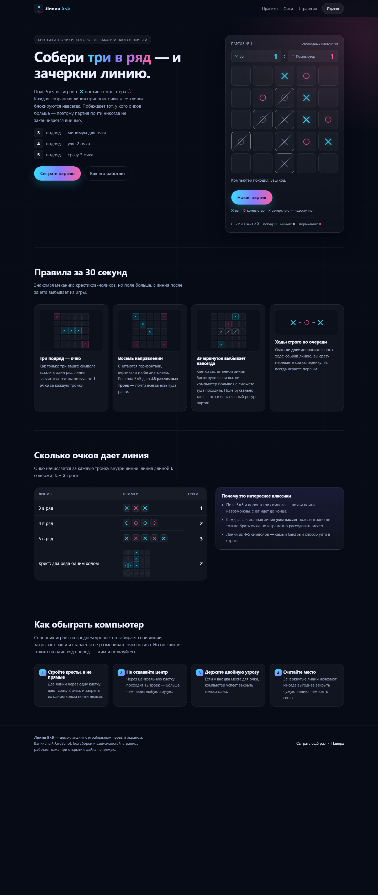
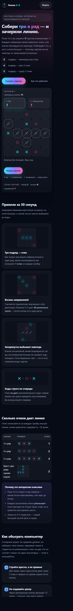

# Линия 5×5 — мини-лэндинг с игрой

**Живая версия:** https://vadimkotovich-pixel.github.io/line-5x5/ — можно просто открыть и играть.

Статический лэндинг, на первом экране которого сразу играбельная партия: поле 5×5,
три символа подряд зачеркиваются и приносят очки, зачеркнутые клетки блокируются
навсегда, побеждает тот, у кого очков больше. Играете против компьютера.

**Открывается двойным щелчком** по `index.html` — ни сервера, ни сборки, ни зависимостей
нужно не больше, чем браузер. Вся игровая логика — ванильный JavaScript.



На телефоне:



## Правила

| Что | Как |
|---|---|
| Поле | 5×5, вы играете ✕, компьютер ○, вы ходите первым |
| Ход | строго по очереди: очко **не** дает дополнительного хода |
| Очко | линия длиной `L ≥ 3` по горизонтали, вертикали или диагонали дает `L − 2` очка |
| 3 в ряд | 1 очко · 4 в ряд — 2 очка · 5 в ряд — 3 очка |
| Крест | один ход, закрывающий два ряда сразу, дает 2 очка |
| Зачеркивание | все клетки засчитанной линии блокируются навсегда |
| Конец партии | нет свободных клеток **или** оставшиеся клетки уже не могут дать тройку |
| Победа | больше очков; при равенстве — ничья |

## Структура

```
index.html                  разметка лэндинга + контейнер игры
assets/css/styles.css       тёмная тема, адаптив, анимации, prefers-reduced-motion
assets/js/rules.js          правила: окна, подсчет очков, блокировки, конец партии
assets/js/ai.js             компьютер: 1-ply эвристика с защитой от угроз
assets/js/ui.js             DOM, клавиатура, доступность, анимации
tests/                      node:test — правила, бот, контракт UI, DOM-прогон (jsdom)
tools/selfplay-stats.cjs    массовые партии: качество бота и инварианты
tools/visual-check.cjs      харнессы для проверки вёрстки в браузере + автопартия
tools/dom-report.cjs        разбор снятого браузером DOM и диагностики вёрстки
tools/check-live.cjs        проверка опубликованной версии на GitHub Pages
tools/encoding-check.cjs    проверка кодировки файлов
screenshots/                desktop.png, mobile-380.png
specs/ plans/ thoughts/     артефакты процесса разработки (bulletproof)
```

Логика ничего не знает о DOM, а `ui.js` не содержит правил игры. Состояние партии
иммутабельно: `Rules.applyMove(state, index, player)` возвращает новое состояние —
именно поэтому бот может безопасно смотреть на ход вперед.

## Компьютер

Для каждой свободной клетки считается

```
ценность = 1000 × (свои очки за ход − лучший ответ соперника) + позиция + шум
```

Первое слагаемое заставляет забирать свои линии, второе — защищаться (именно оно не дает
боту обменять свое очко на два очка соперника), третье различает равные по выгоде ходы,
а шум меньше единицы лишь перемешивает полностью одинаковые варианты.

Замеры (`npm run stats`, 300 партий на каждый сценарий):

| Сценарий | Очки в среднем за партию | Итоги бота |
|---|---|---|
| бот против случайного игрока | 2.57 : 0.48 | 298 побед, 2 ничьи, 0 поражений |
| бот против бота | — | 24 победы, 265 ничьих, 11 поражений |
| итого бот против случайного | 1518 : 365 | — |

## Тесты

```bash
npm install            # или pnpm install — нужна только dev-зависимость jsdom
npm test               # 46 тестов
npm run test:logic     # правила и бот, без jsdom
npm run stats          # статистика self-play
npm run check          # синтаксис трех скриптов
npm run encoding       # кодировка файлов: BOM и двойная перекодировка
npm run visual         # харнессы для проверки вёрстки в браузере
npm run live           # проверить, что GitHub Pages отдаёт все файлы
```

`--test-isolation=none` в скриптах тестов стоит потому, что `node --test` по умолчанию запускает
каждый файл в отдельном процессе, а в ограниченных средах (песочница, часть CI) это запрещено.
Там, где порождение процессов разрешено, работает и обычный `node --test tests/`. Если pnpm
ругается на junction-ссылки и не находит зависимость jsdom — помогает `pnpm install --node-linker=hoisted`.

Что покрыто:

- **правила** — 48 окон, все направления, `L − 2` очков, блокировка клеток, оба условия
  конца партии, определение победителя, иммутабельность. Очки каждого хода дополнительно
  перепроверяются независимой реализацией (полное сканирование поля) на 300 партиях;
- **бот** — забирает свое очко, блокирует чужую тройку, предпочитает 2 очка 1 очку, не меняет
  1 на 2, всегда возвращает легальный ход, 300 партий бот-против-бота завершаются;
  свойства проверены на случайных позициях;
- **контракт UI** — все элементы, которые ищет `ui.js`, есть в разметке; стили покрывают
  каждый класс из разметки и из `ui.js`; подключены classic-скрипты (страница работает
  по `file://`); кодировка файлов без BOM и без двойной перекодировки;
- **DOM (jsdom)** — страница стартует сама, поле и мини-схемы собираются, ход игрока,
  пауза «компьютер думает», ответ компьютера, стрелки/Home/End, клик по зачеркнутой клетке,
  партия до конца с синхронизацией интерфейса и правил, итог, серия партий, сброс партии
  во время хода компьютера.

## Визуальная проверка

jsdom не считает геометрию и не рисует, поэтому вёрстка проверялась настоящим браузером:

```bash
npm run visual                  # создает _visual-check.html и _narrow-check.html
# затем headless Chrome по командам из комментария в tools/visual-check.cjs
node tools/dom-report.cjs       # разбирает снятый DOM: состояние поля + диагностика вёрстки
```

Результат (`screenshots/desktop.png`, `screenshots/mobile-380.png`): середина партии со счетом
1 : 1, четырьмя знаками каждой стороны и шестью зачеркнутыми клетками; переполнение вёрстки
`overflow=0` на ширинах 1422 и 380 CSS px; русский текст без искажений.

Две ловушки среды, из-за которых проверку пришлось делать именно так:

- **Кодировка.** `Get-Content`/`Set-Content` в Windows PowerShell читает UTF-8 без BOM как ANSI
  и превращает русский текст в нечитаемые пары латинских букв с диакритикой. Поэтому харнессы
  генерирует Node, а в `tests/ui-contract.test.js` стоит сторож на BOM и двойную перекодировку
  (он же не даст процитировать испорченный текст в документации).
- **Минимальная ширина окна.** Headless Chrome на Windows не делает окно уже ~500 px: при
  `--window-size=400` реальный `clientWidth` равен 504. Узкий вьюпорт проверяется через
  iframe шириной 380 px, а не через размер окна.

Чего по-прежнему не проверяет автоматика: как страница выглядит в Safari/Firefox и на реальном
телефоне (устройства с DPR > 1, тач-жесты).

## Лицензия

[MIT](LICENSE) — используйте, меняйте и распространяйте свободно, сохраняя упоминание авторства.
